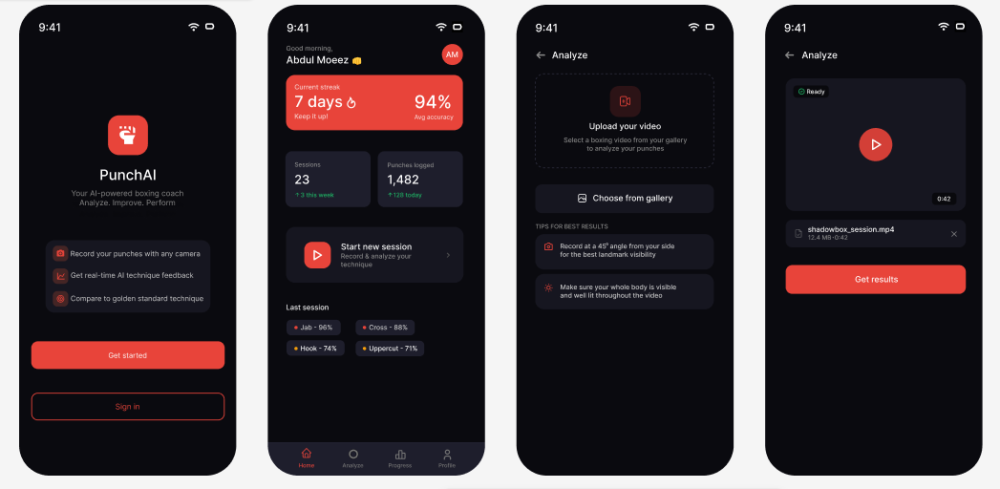

# AI-Based Boxing Assistant

An AI-assisted boxing training application that recognizes common boxing
punches from video and provides technique feedback. The project combines
a Flutter mobile app, a FastAPI backend, and a Python computer-vision
and deep-learning pipeline.

> **Project status:** Academic Final Year Project (FYP). The research
> manuscript is being submitted for review; it is not described here as
> published or accepted. Deployment and environment-specific setup still
> need to be verified.

## Overview

The AI-Based Boxing Assistant is designed to help beginner boxers
practise and understand their punches using video-based analysis. It
uses pose landmarks and a hierarchical classification pipeline to
identify punch types. After classification, the system can compare
movement patterns with expert reference sequences to provide
direction-specific technique feedback.

The **Record Session** flow provides audio-based camera-position
guidance. Boxing technique feedback is displayed as text.

This project is a learning and training aid, not a replacement for a
qualified boxing coach.

## Key Features

-   Recognizes six punch types: jab, cross, lead hook, rear hook, lead
    uppercut, and rear uppercut.
-   Processes recorded or uploaded video.
-   Extracts 2D pose landmarks using MediaPipe.
-   Uses a hierarchical sequence-classification pipeline.
-   Compares movement sequences with expert references using Dynamic
    Time Warping (DTW).
-   Provides audio-based guidance to help adjust camera positioning
    during Record Session.
-   Displays boxing technique feedback as text.
-   Includes user accounts, dashboard/session information, profile,
    settings, and support screens in the Flutter app.

## How It Works

1.  The user records a session or provides a video for analysis.
2.  Audio guidance helps the user adjust the camera angle during Record
    Session.
3.  MediaPipe extracts 2D body landmarks.
4.  Landmark coordinates are normalized and converted into model
    features.
5.  The pipeline separates punch movements into individual sequences.
6.  A hierarchy of models classifies each punch.
7.  Dynamic Time Warping (DTW) compares movement sequences with expert
    references.
8.  The app presents technique feedback as text and updates session
    information where supported.

## Technology Stack

  Component                        Technologies
  -------------------------------- ------------------------------------------------
  Mobile app                       Flutter, Dart
  User accounts and session data   Firebase
  Backend API                      Python, FastAPI
  Pose estimation                  MediaPipe
  Machine learning                 TensorFlow, LSTM-based sequence classification
  Movement comparison              Dynamic Time Warping (DTW)

The research experiments report Python 3.10.8, MediaPipe 0.10.13, and
TensorFlow 2.15.0. These versions may not match every current local
environment.

## Project Structure

The current top-level structure is expected to look like this after the
app ZIP has been extracted. Keep the combined folder name exactly as it
currently exists.

``` text
AI-Based-Boxing-Assistant/
├── Backend/
├── Models/
├── Preprocessing, Training, Testing/
├── FlutterApp/                 # Extracted Flutter app; actual name may differ
├── docs/
│   └── screenshots/
├── README.md
└── .gitignore
```

### Folder descriptions

-   **`Backend/`** --- FastAPI backend code and related resources.
-   **`Models/`** --- Trained model files and model-related resources.
    Large files may need Git LFS or separate hosting.
-   **`Preprocessing, Training, Testing/`** --- One combined folder
    containing Python code related to preprocessing, training, testing,
    inference, and sequence/landmark preparation.
-   **`FlutterApp/`** --- The Flutter app source after extracting
    `aiboxapp_live_camera (1).zip`. Update this name in the README if
    the extracted folder has a different name.
-   **`docs/screenshots/`** --- Screenshots of the app interface.

Do not commit ZIP backups, generated build folders, virtual
environments, caches, credentials, API keys, Firebase service-account
private keys, or local configuration files containing secrets.

## Research and Evaluation

The associated manuscript is titled **"Monocular Boxing Punch
Recognition: Technique Feedback and 3D Pose Analysis."**

The reported pipeline uses 2D MediaPipe landmarks, hierarchical
LSTM-based classification, and DTW comparison against expert reference
sequences.

The manuscript reports:

-   **Evaluation set:** 425 punch sequences from three held-out
    subjects.
-   **Accuracy:** 96.94% (412 correct predictions out of 425).
-   **95% Wilson confidence interval:** 94.84%--98.20%.
-   **Reported processing time:** Approximately 398 seconds to process a
    one-minute video containing 25 detected punches in the reported
    setup.

These figures describe the reported experiment and do not guarantee
performance for every user, camera, device, or environment. The
manuscript is being sent for review.

## Known Limitations

-   The held-out evaluation included only three subjects; broader
    testing is needed.
-   The reported experiments used a single camera viewpoint.
-   Southpaw-specific performance was not evaluated.
-   Some confusion remained between cross and rear-hook classes.
-   The reported inference workflow was offline and took approximately
    398 seconds for the one-minute example; this result does not
    establish real-time performance.
-   Feedback thresholds have not been independently validated against
    coach-labelled technique errors.
-   Results can vary with lighting, camera placement, body visibility,
    recording quality, and execution style.

## Setup and Running

Exact commands should be confirmed against the extracted folders and
their dependency files before being treated as final.

### Prerequisites

-   A Python version compatible with the backend and model dependencies.
-   Flutter SDK compatible with the app's `pubspec.yaml`.
-   Firebase configuration for app features that use Firebase.
-   Required model files and Python dependencies.

### Python backend and pipeline

1.  Open the relevant Python project folder.
2.  Create and activate a virtual environment.
3.  Install dependencies from the project's dependency file, if present.
4.  Configure required environment variables and model paths.
5.  Start FastAPI using the entry point defined in the backend source.

Create a virtual environment:

``` bash
python -m venv .venv
```

Windows PowerShell:

``` powershell
.venv\Scripts\Activate.ps1
```

macOS/Linux:

``` bash
source .venv/bin/activate
```

The dependency-installation and server-start commands are intentionally
not specified until the actual dependency files and FastAPI entry point
have been checked.

### Flutter app

1.  Install the Flutter SDK.
2.  Open a terminal in the extracted Flutter app directory.
3.  Configure Firebase for your own Firebase project, if required.
4.  Fetch dependencies and run the app:

``` bash
flutter pub get
flutter run
```

These commands assume the extracted directory is the Flutter project
root and contains `pubspec.yaml`. Additional platform-specific
configuration may be required.

## Security and GitHub Upload Notes

-   Remove passwords, tokens, API keys, private certificates, and
    Firebase service-account keys.
-   Do not commit personal user data or private training videos.
-   Use `.gitignore` to exclude build outputs, caches, local
    environments, and secret configuration.
-   Check the size of model weights and other binary files before
    pushing. GitHub blocks regular Git files larger than 100 MiB; Git
    LFS or external model hosting may be suitable for large assets.
-   Keep local ZIP archives as backups rather than uploading them as
    source code.
-   Confirm permission to publish included datasets, reference
    sequences, and model files.

## Screenshots

If the following files are present in `docs/screenshots/`, GitHub will
display them here.

### App overview



### Punch analysis and authentication


### Profile, settings, and support


## Research Manuscript

**Title:** *Monocular Boxing Punch Recognition: Technique Feedback and
3D Pose Analysis*

The manuscript is being submitted for review. Do not describe it as
published or accepted unless its status changes.

## Contributors

-   Abdul Moeez
-   Ayesha Niazi
-   Syeda Maleeha Bano Naqvi
-   Erum Ashraf

**Department of Computer Science, Bahria University, Islamabad**

------------------------------------------------------------------------

This repository documents an academic project. Verify paths,
dependencies, configuration, model availability, and setup commands
against the actual source before running or deploying it.
